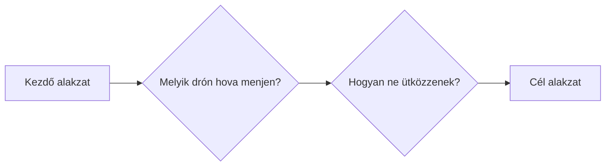
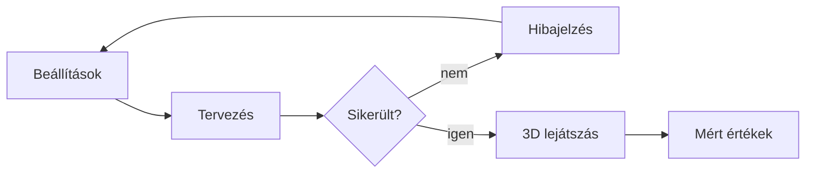

<!-- 5xl -->
# Drónrajok optimális útvonaltervezésének és formációváltásának vizsgálata

Szerző: Tolnai-Tóth Zétény  
Neptun: YV4RVH  
Témavezető: Oláh Gábor  
Projektazonosító: 2026-OG-03

---

<!-- @slide Probléma -->

## Probléma

Egy drónraj egyik alakzatból a másikba vált.

Közben: idő, út, valós sebesség- és gyorsuláskorlát.

<!-- @note -->
> Példa: augusztus 20-i drónshow, több száz drón, másodpercek alatt új alakzat.
> Két összefonódó kérdés: hozzárendelés és ütközéselkerülés.
> Rossz hozzárendelésnél sokkal több az ütközés.

---

<!-- @slide Célfelhasználók -->

## Célfelhasználók

### Show-tervező

Kivitelezhető-e az átmenet? Mennyi ideig tart?

### Kísérletező

Hogyan működnek és miben térnek el a stratégiák?

<!-- @note -->
> Nincs bejelentkezés: mindenki ugyanazt a felületet használja, csak más céllal.
> Show-tervező: melyik megoldás a legjobb az adott drónokkal.
> Kísérletező: hallgató vagy kutató, a stratégiák összehasonlítása.

---

<!-- @slide Tervezett hatókör -->

## Tervezett hatókör

<!-- @columns 2 6 -->

### Benne van

- Presetek és egyedi pozíciólista
- Állítható sebesség, gyorsulás, biztonsági távolság
- 3 hozzárendelési stratégia
- Ütközéskezelés szintenként
- Mérések, összehasonlítás
- 3D lejátszás böngészőben

<!-- @col-break -->

### Nincs benne

- Futás közbeni alakzatváltás
- Akadályok
- Eltérő tulajdonságú drónok
- Részletes fizika (szél, akku)
- Felhasználói fiókok

<!-- @columns -->

<!-- @note -->
> Presetek: rács, gömb, kör, spirál; 10, 50, 100 és 500 drónnal.
> Hozzárendelés: naiv, mohó, optimális (magyar módszer).

---

<!-- @slide Ütközéskezelési szintek -->

## Ütközéskezelés szintenként

<!-- @scale 90% -->
| Szint | Működés | Prioritás |
| --- | --- | --- |
| **0. Alap** | Egyenes pálya, az ütközést csak **jelzi** | Kötelező |
| **1. Késleltetés** | Az egyik drón **később indul** | Kötelező |
| **2. Lassítás** | Menet közben **lassít, megvár** | Ajánlott |
| **3. Kitérés** | Nem egyenes pályán **kikerüli** | Lehetséges |

<!-- @reveal -->
<!-- @callout warning -->
> **Helycsere** egyenes pályán nem oldható fel, csak a 3. szinten.

<!-- @note -->
> A hozzárendelés és az ütközéskezelés külön választható, bármelyik kombinálható.
> A 0. szint a viszonyítási alap: ehhez mérjük a többletidőt.
> Ezért számít a hozzárendelés: a naiv sok helycserét és keresztezést ad.

---

<!-- @slide Kezdeti felhasználói utak -->

## Kezdeti felhasználói utak

<!-- @columns 2 6 -->

1. **Tervezés:** alakzat, paraméter, stratégia, szint
2. **3D lejátszás**, ütközők pirossal

<!-- @col-break -->

3. **Összehasonlítás** táblázatban
4. **Egyedi formáció:** JSON / CSV

<!-- @columns -->

<!-- @note -->
> Sikertelen tervezés: a választott szint nem tudja feloldani az ütközést.
> Összehasonlítás: ugyanarra a bemenetre több stratégia és szint, idő, távolság, ütközések egy táblázatban.

---

<!-- @slide Következő lépések -->

## Következő lépések